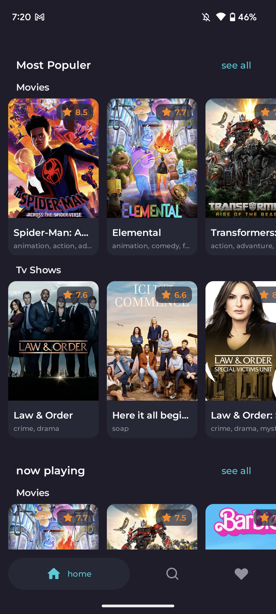
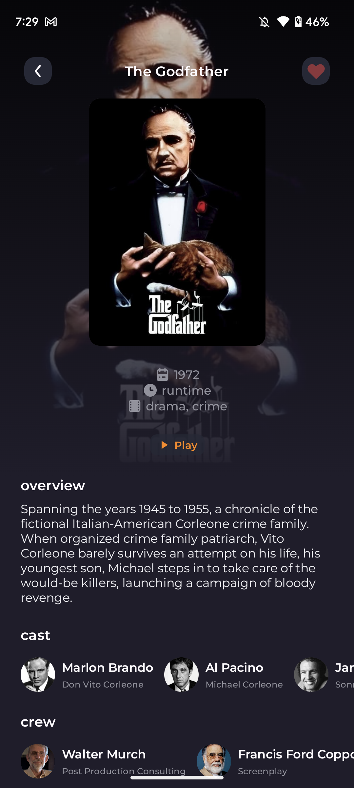
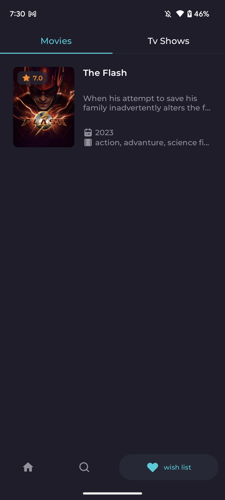
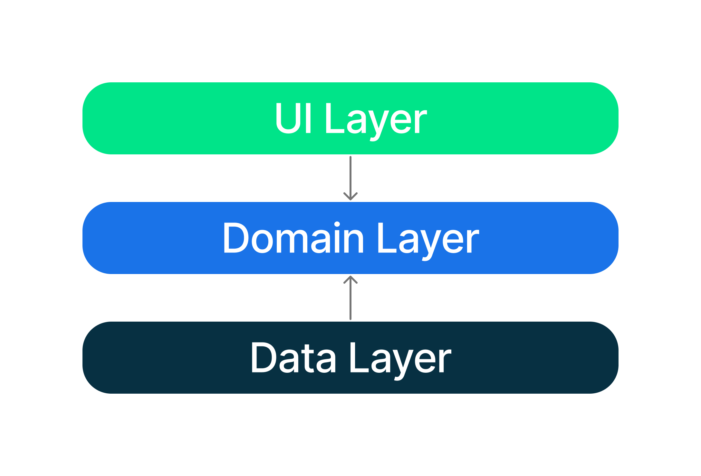

<p align="center">
  
</p>

<h1 align="center">NoFlix – Watch Movies &amp; TV Series Ad-Free on Android</h1>

<p align="center">
  <b>A free, open-source Android app to stream movies and TV shows with no ads, no pop-ups and no trackers.</b><br/>
  Built-in ad blocker · Full-screen player · No sign-up · Made with Kotlin &amp; Jetpack Compose
</p>

<p align="center">
  <a href="https://github.com/zobaer53/NoFlix/releases/latest/download/NoFlix.apk"></a>
  <a href="https://zobaer53.github.io/NoFlix/"></a>
</p>

<p align="center">
  <a href="https://github.com/zobaer53/NoFlix/releases/latest"></a>
  <a href="https://github.com/zobaer53/NoFlix/releases"></a>
  <a href="https://android-arsenal.com/api?level=26"></a>
  <a href="LICENSE.txt"></a>
  <a href="https://github.com/zobaer53/NoFlix/stargazers"></a>
</p>

.png>)

## What is NoFlix?

**NoFlix** is an **ad-free movie and TV series streaming app for Android**. Browse trending, popular, top-rated and upcoming movies and TV shows, read the details, save favourites to your watchlist, and press **Play** to watch in a clean, full-screen player. Ads, pop-ups, redirects and trackers are blocked with a built-in ad blocker.

If you've been looking for a way to **watch free movies without ads**, **stream TV series without pop-ups**, or find a **Netflix-style app without ads** that is free and open source, NoFlix is for you.

## Features

- 🚫 **Ad-free streaming.** A built-in ad blocker (AdGuard / EasyPrivacy filter lists and a native ad-block engine) removes ads, pop-ups, redirects and crypto-miners.
- 🎬 **Movies and TV series.** Trending, popular, top-rated, now playing, upcoming and discover lists, powered by [The Movie Database (TMDB)](https://www.themoviedb.org/).
- ▶️ **One-tap full-screen player.** Videos open in landscape full screen; the rest of the app stays portrait.
- 🔍 **Search** any movie or TV show by title.
- ❤️ **Watchlist.** Save movies and series to watch later.
- 📶 **Offline browsing.** Lists and details are cached, so you can browse without a connection.
- 🔒 **Private.** No account, no sign-up, no analytics.
- 🎨 **Modern design.** Material 3, dark theme and smooth Jetpack Compose UI.

## Download

Get the latest signed APK from **[GitHub Releases](https://github.com/zobaer53/NoFlix/releases/latest)**. Every update on `master` is published there automatically.

1. Download `NoFlix.apk` on your Android phone (Android 8.0 or newer).
2. Open it and allow *Install unknown apps* if prompted.
3. Open NoFlix, pick a movie or series and tap **Play**.

## Demo

https://github.com/zobaer53/zeDMoviesApp/assets/61627836/3743cf43-8afc-4984-b392-b425784ef823

## Screenshots

<table width="100%">
  <tbody>
    <tr>
      <td width="25%"></td>
      <td width="25%"></td>
      <td width="25%"></td>
      <td width="25%"></td>
    </tr>
  </tbody>
</table>

## FAQ

**Is NoFlix free?**
Yes. NoFlix is completely free and open source under the Apache 2.0 license, and it has no ads or in-app purchases.

**How do I watch movies without ads on Android?**
Install NoFlix, search for a movie or TV show and tap Play. The built-in ad blocker filters every request the player makes, so ads and pop-ups never load.

**Do I need an account?**
No. NoFlix works without sign-up or login.

**Is NoFlix on the Google Play Store?**
No. Download the APK from [GitHub Releases](https://github.com/zobaer53/NoFlix/releases/latest).

**Does NoFlix host any videos?**
No. See the [disclaimer](#disclaimer) below.

## Tech stack & architecture

NoFlix follows the [official Android architecture guidance](https://developer.android.com/topic/architecture) (data, domain and UI layers):

- **Kotlin**, **Coroutines & Flow**
- **Jetpack Compose**, Material 3, Navigation Compose
- **Hilt** for dependency injection
- **Retrofit** + **kotlinx.serialization** for the TMDB API
- **Room** + **Paging 3** (RemoteMediator) for offline caching
- **DataStore**, **Coil**, **Lottie**
- **WebView** with an AdGuard-compatible ad-blocking engine (C++ via JNI)



## Build from source

1. Clone the repo and open it in Android Studio.
2. Get a free API key from [The Movie DB](https://www.themoviedb.org/settings/api) and add it to `local.properties`:
   ```properties
   API_KEY="yourApiKey"
   ```
3. Install **CMake 3.10.2** and the **NDK** from *SDK Manager → SDK Tools* (needed by the native ad-block library; see [this Stack Overflow answer](https://stackoverflow.com/questions/71853200/cmake-3-10-2-not-found-in-sdk-path-or-by-cmake-dir-prop) if CMake isn't found).
4. Run `./gradlew :app:installDebug` or press Run in Android Studio.

## Contributing

Issues and pull requests are welcome. If NoFlix helps you watch movies and TV series without ads, please ⭐ **star the repo**. It helps other people find it.

## Disclaimer

NoFlix does not host, upload or store any video files. Movie and TV metadata comes from the TMDB API, and playback loads publicly available third-party web pages. NoFlix is not endorsed or certified by TMDB. You are responsible for complying with the laws in your country.

## Credits

- UI design from [Figma Community](https://www.figma.com/community/file/1088719884686291024)
- Ad blocking based on [AdblockAndroid](https://github.com/Edsuns/AdblockAndroid), [AdGuard filters](https://github.com/AdguardTeam/AdguardFilters) and Brave's ad-block engine
- Movie and TV data from [TMDB](https://www.themoviedb.org/)

## Contact

📫 **hossain.zobaer11858@gmail.com**

<p align="left">
<a href="https://www.linkedin.com/in/zobaer53/" target="blank"></a>
<a href="https://medium.com/@zobaer53" target="blank"></a>
<a href="https://www.hackerrank.com/zobaer53" target="blank"></a>
<a href="https://www.sololearn.com/profile/15909016" target="blank"></a>
<a href="https://stackoverflow.com/users/zobaer-hossain" target="blank"></a>
</p>

## License

```
Copyright 2023 zobaer53 (Zobaer Hossain)

Licensed under the Apache License, Version 2.0 (the "License");
you may not use this file except in compliance with the License.
You may obtain a copy of the License at

   http://www.apache.org/licenses/LICENSE-2.0

Unless required by applicable law or agreed to in writing, software
distributed under the License is distributed on an "AS IS" BASIS,
WITHOUT WARRANTIES OR CONDITIONS OF ANY KIND, either express or implied.
See the License for the specific language governing permissions and
limitations under the License.
```

<!-- Keywords: ad free movies app, ad-free TV series app, watch movies without ads, free movie streaming app Android, no ads movie app APK, adblock movie player, open source Netflix alternative, Kotlin Jetpack Compose movie app, TMDB movie app -->
