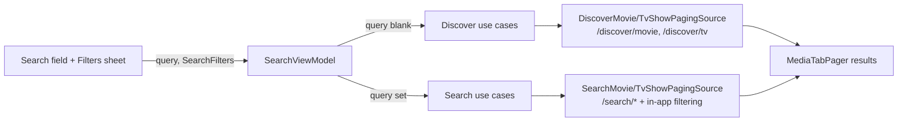

# NoFlix: Search filters

_As of 14 Oct 2026 · Zobaer Hossain_

## Goal

Let users narrow movies and TV shows on the Search tab with the filters TMDB offers: genre, release year, rating, original language, sort order and more. Filters must work with no search text ("show me Korean thrillers rated 7+ from 2015–2024") and, where TMDB allows it, together with search text ("Batman", movies from 2000–2010).

This document is the plan and the progress tracker.

## Progress

| Phase | Status | Tested |
| --- | --- | --- |
| 1. Core filters, no search text | Done (14 Oct 2026) | 17 JVM unit tests; full Maestro suite incl. new `07_filters.yaml` on a Pixel 6a (Android 17) |
| 2. Filters with search text | Done (14 Oct 2026) | 23 JVM unit tests; full Maestro suite incl. extended `07_filters.yaml` on a Pixel 6a |
| 3. More filters | Done (14 Oct 2026) | 33 JVM unit tests; full Maestro suite incl. extended `07_filters.yaml` on a Pixel 6a (en-US) |

Open decisions were taken with the recommended defaults: one filter set for both tabs, filters reset on each launch (kept across process death only), applied with "Show results".

## What TMDB offers

The key constraint: **TMDB's search endpoints barely filter, and its discover endpoints can't search by text.**

| Endpoint | Text query | Filters |
| --- | --- | --- |
| `GET /search/movie` (used today) | Yes | `year`, `primary_release_year`, `region`, `include_adult` only |
| `GET /search/tv` (used today) | Yes | `year`, `first_air_date_year`, `include_adult` only |
| `GET /discover/movie` | **No** | Everything in the table below |
| `GET /discover/tv` | **No** | Everything in the table below |

So the plan has two modes:

- **Discover mode** (search text empty, at least one filter set): call `/discover/*` with all the filters. TMDB does the filtering and sorting.
- **Search mode** (search text present): call `/search/*`. Pass the year filter to TMDB; apply the other filters to each page of results in the app (see "Filters with search text" below). Filters that can't be checked against a search result are greyed out.

### Discover parameters

Values in a list are joined with `,` for AND and `|` for OR (`with_genres=28|12` means action **or** adventure).

| Filter | `/discover/movie` | `/discover/tv` | In app? |
| --- | --- | --- | --- |
| Sort | `sort_by`: `popularity`, `vote_average`, `vote_count`, `primary_release_date`, `revenue`, `title`, `original_title` (each `.asc`/`.desc`) | `sort_by`: `popularity`, `vote_average`, `vote_count`, `first_air_date`, `name`, `original_name` | Phase 1 |
| Genres (include) | `with_genres` | `with_genres` | Phase 1 |
| Genres (exclude) | `without_genres` | `without_genres` | Phase 3 |
| Release / air date range | `primary_release_date.gte/.lte`, `release_date.gte/.lte`, `primary_release_year`, `year` | `first_air_date.gte/.lte`, `first_air_date_year`, `air_date.gte/.lte` | Phase 1 (year range) |
| Rating | `vote_average.gte/.lte` (0–10) | `vote_average.gte/.lte` | Phase 1 (minimum only) |
| Minimum votes | `vote_count.gte/.lte` | `vote_count.gte/.lte` | Phase 1 (hidden default), Phase 3 (visible) |
| Original language | `with_original_language` (ISO 639-1, e.g. `ko`) | `with_original_language` | Phase 1 |
| Origin country | `with_origin_country` (ISO 3166-1) | `with_origin_country` | Phase 3 |
| Runtime (minutes) | `with_runtime.gte/.lte` | `with_runtime.gte/.lte` (episode length) | Phase 3 |
| Age rating | `certification`, `certification.gte/.lte`, `certification_country` | Not available | Phase 3 (movies only) |
| Streaming service | `with_watch_providers`, `watch_region`, `with_watch_monetization_types` | Same | Phase 3 |
| TV network | Not available | `with_networks` (e.g. 213 = Netflix, 49 = HBO) | Phase 3 (TV only) |
| TV status | Not available | `with_status` (0 Returning, 1 Planned, 2 In production, 3 Ended, 4 Cancelled, 5 Pilot) | Phase 3 (TV only) |
| TV type | Not available | `with_type` (0 Documentary, 1 News, 2 Miniseries, 3 Reality, 4 Scripted, 5 Talk show, 6 Video) | Phase 3 (TV only) |
| Release type | `with_release_type` (1 Premiere … 3 Theatrical, 4 Digital, 5 Physical, 6 TV), `region` | Not available | Later |
| People, companies, keywords | `with_cast`, `with_crew`, `with_people`, `with_companies`, `with_keywords` (+ `without_*`) | `with_companies`, `with_keywords` | Later (needs a person/keyword picker backed by `/search/person`, `/search/keyword`) |
| Adult content | `include_adult` | `include_adult` | Never exposed: always `false` |

Lookup endpoints for building the pickers:

| Data | Endpoint | Notes |
| --- | --- | --- |
| Genres | `/genre/movie/list`, `/genre/tv/list` | The app already hard-codes TMDB genre IDs in `NetworkGenreWithId` (`data/network/model/common/NetworkGenre.kt`) with string resources, so Phase 1 doesn't need these calls. |
| Languages | `/configuration/languages` | ~190 entries. Show a short list of common ones first. |
| Countries | `/configuration/countries` | For origin country and watch region. |
| Age ratings | `/certification/movie/list` | Per country (US: G, PG, PG-13, R, NC-17). |
| Streaming services | `/watch/providers/movie`, `/watch/providers/tv` with `watch_region` | Logos included; data comes from JustWatch and must be credited. |
| Watch regions | `/watch/providers/regions` | |

Two TMDB behaviours to plan for:

- Sorting by rating without a vote floor puts films with one 10/10 vote first. When sort is "Rating", send `vote_count.gte=200` (movies) / `100` (TV) unless the user set their own.
- Discover never returns more than page 500. Stop paging at `min(total_pages, 500)`.

## Where it fits in the app

Today's search path, all network-only Paging 3 (`PagingSource`, no Room):

```
SearchScreen ─ SearchViewModel ─ SearchMoviesUseCase / SearchTvShowsUseCase
             ─ MovieRepository.search(query) / TvShowRepository.search(query)
             ─ SearchMoviePagingSource / SearchTvShowPagingSource
             ─ MovieNetworkDataSource.search() → MovieService.search()  (/search/movie)
```

The search field drives `SearchUiState.query`. A non-blank query sets `isSearching`, which swaps the Discover/Trending suggestions for a `MediaTabPager` with Movies and TV Shows tabs. Changing the query creates a new paged flow after a 500 ms debounce.

The plan keeps that shape and adds a filter object next to the query:



## Design

### Domain model

A new `domain/model/SearchFiltersModel.kt`, shared by both tabs:

```kotlin
data class SearchFiltersModel(
    val sort: SortModel = SortModel.POPULARITY_DESC,
    val genres: Set<FilterGenreModel> = emptySet(),
    val genreMatch: GenreMatch = GenreMatch.ANY,   // `|` or `,`
    val yearFrom: Int? = null,
    val yearTo: Int? = null,
    val minRating: Double? = null,                 // 0.0–10.0
    val originalLanguage: String? = null,          // ISO 639-1
    // Phase 3: minVotes, runtime range, originCountry, certification,
    // watchProviders + watchRegion, tvNetworks, tvStatus, tvType, excludedGenres
) {
    val isActive: Boolean get() = this != SearchFiltersModel()
}
```

**One filter set for both tabs.** Users think "horror from the 90s", not "horror movies, and separately horror shows". Movie and TV genre IDs differ, so `FilterGenreModel` is a user-facing genre that maps to one ID per media type:

| Filter genre | Movie ID | TV ID |
| --- | --- | --- |
| Action | 28 | 10759 (Action & Adventure) |
| Adventure | 12 | 10759 |
| Science fiction | 878 | 10765 (Sci-Fi & Fantasy) |
| Fantasy | 14 | 10765 |
| War | 10752 | 10768 (War & Politics) |
| Animation, Comedy, Crime, Documentary, Drama, Family, Mystery, Western | same ID on both | |
| Horror, Thriller, Romance, History, Music, TV Movie | movie only | none |
| Kids, News, Reality, Soap, Talk | none | TV only |

When a selected genre has no ID for a tab, that tab shows a short empty state ("Horror isn't a TV genre on TMDB") instead of quietly dropping the genre.

`SortModel` lists only sorts both endpoints support (popularity, rating, release/first-air date, title/name, each ascending or descending) and maps to the right `sort_by` per type. Revenue is movie-only and left out.

### Data layer

- `data/network/util/Constants.kt`: add the discover parameter names (`SORT_BY`, `WITH_GENRES`, `VOTE_AVERAGE_GTE`, …).
- `MovieService` / `TvShowService`: add `discover(@QueryMap filters: Map<String, String>, language, page)`. A `@QueryMap` keeps the interface stable as Phase 3 adds parameters. The existing parameterless `getDiscover()` stays for the Room-cached Discover row on the Home and Search screens.
- `data/mapper/SearchFiltersMapper.kt`: `SearchFiltersModel.asDiscoverMovieQuery()` / `asDiscoverTvQuery()` → `Map<String, String>`. Pure functions, unit-tested. Year range → `primary_release_date.gte=YYYY-01-01` / `.lte=YYYY-12-31` (movies), `first_air_date.gte/.lte` (TV). Always adds `include_adult=false`.
- `MovieNetworkDataSource` / `TvShowNetworkDataSource`: `discover(filters, language, page)` passthroughs.
- New `data/paging/DiscoverMoviePagingSource.kt` / `DiscoverTvShowPagingSource.kt`, modelled on the search sources. End of paging is `page >= min(totalPages, 500)`, not "empty page". Network only: filtered results aren't cached in Room, the same as search today.
- `SearchMoviePagingSource` / `SearchTvShowPagingSource`: take the filters too (see next section).
- `MovieRepository` / `TvShowRepository`: `discover(filters): Flow<PagingData<…>>`; `search(query)` becomes `search(query, filters)`.

### Filters with search text

`/search/*` accepts only a year. For the rest the app filters each page itself, using fields already in every search result (`NetworkMovie` / `NetworkTvShow`):

| Filter | With search text |
| --- | --- |
| Year range | Single year: sent to TMDB (`primary_release_year` / `first_air_date_year`). Range: checked in the app against `release_date` / `first_air_date`. |
| Genres | In the app, against `genre_ids` |
| Minimum rating | In the app, against `vote_average` |
| Original language | In the app, against `original_language` |
| Sort | **Disabled**: results stay in TMDB's relevance order (sorting one page at a time would be misleading) |
| Phase 3 filters (runtime, age rating, streaming service, network, status) | **Disabled**: not in search results |

A strict filter can leave a page with zero matches. The paging source then fetches the next TMDB page inside the same `load()`, up to 5 pages, and returns what it has (possibly an empty page with a `nextKey`) so the list never stalls or loops forever. Paging stops at `total_pages`.

Disabled filters stay visible in the sheet with a note: "Clear the search text to sort or use this filter".

### ViewModel and state

- `SearchUiState` gains `filters: SearchFilters` (UI-layer copy, mapped to the domain model like `Movie` ↔ `MovieModel`).
- `isSearching` becomes `query.isNotBlank() || filters.isActive`: filters alone show results.
- New `SearchEvent`s: `ApplyFilters(filters)`, `RemoveFilter(key)`, `ResetFilters`.
- One function builds both paged flows from `(query, filters)`: blank query → discover use cases, else search use cases. Filter changes skip the debounce; query changes keep the 500 ms debounce.
- New use cases `DiscoverMoviesUseCase` / `DiscoverTvShowsUseCase`; `SearchMoviesUseCase` / `SearchTvShowsUseCase` gain a `filters` parameter.
- Store the filters in the `SavedStateHandle` so they survive process death. Whether to remember them across app launches is an open decision (default: no).

### UI

Built from Material 3 components already in the Compose BOM (2026.09.00), styled with `zedMoviesTheme`:

1. **Filter button** with a badge (number of active filters) at the end of the search field, next to the clear button. Content description "Filters", so Maestro can tap it.
2. **Active-filter chips** in a horizontal row under the search field, only when filters are active: "Horror ✕", "2015–2024 ✕", "7+ ★ ✕", plus "Clear all". Tapping ✕ removes that filter immediately.
3. **Filters bottom sheet** (`ModalBottomSheet`), applied with a "Show results" button rather than on every change, so moving a slider doesn't fire a request per step:
   - Sort: single-choice chips (Popular, Top rated, Newest, Oldest, A–Z).
   - Genres: `FilterChip` grid, with an "any / all" toggle. Reuse the existing genre string resources (fix the `action advanture` typo while there).
   - Release year: `RangeSlider` from 1900 to next year, with the two values shown as text.
   - Minimum rating: `Slider` in 0.5 steps, shown as "7.0+ ★".
   - Original language: a short list of common languages (English, Korean, Japanese, Hindi, Spanish, French, Chinese, Bengali, …) plus "More…" opening the full `/configuration/languages` list.
   - "Reset" in the sheet header.
4. **Results** reuse `MediaTabPager` + `MoviesContainer` / `TvShowsContainer` unchanged. Add an empty state ("No titles match these filters" + "Clear filters") for zero results, which search lacks today.

The Phase 3 filters go in a collapsible "More filters" section of the same sheet, with TV-only items marked "TV only".

### Lookup data

- Genres: from the hard-coded `NetworkGenreWithId` enum. No network call.
- Languages, countries, age ratings, streaming services: fetched once on first open of the sheet and kept in memory for the session (they rarely change). Cache them in Room or DataStore only if loading the sheet turns out slow. If the fetch fails, the sheet still opens and that section shows a retry.
- Existing risk to fix in Phase 1: `NetworkGenreWithId[id]` uses `checkNotNull`, so a new genre ID from TMDB would crash any list. Discover returns a much wider range of titles than today's lists, which makes that more likely. Map unknown IDs to "no genre" instead.

## Phases

Each phase is shippable on its own and is tested with the Maestro suite before moving on (`.maestro/run.sh`). Remember that a push to `master` publishes a release.

### Phase 1: Core filters, no search text

- [x] `SearchFiltersModel`, `FilterGenreModel` (with the per-type ID table), `SortModel`.
- [x] Discover parameter constants, `discover(@QueryMap)` on both services, network data source passthroughs.
- [x] `SearchFiltersMapper` + JVM unit tests (genre mapping, year → date bounds, rating sort adds the vote floor, `include_adult=false`).
- [x] ~~`DiscoverMoviePagingSource` / `DiscoverTvShowPagingSource`~~ one shared `TmdbPagingSource`, repository methods, use cases.
- [x] Unknown genre IDs no longer crash.
- [x] ViewModel: filters in state and `SavedStateHandle`, `isSearching` rule, new events.
- [x] UI: filter button + badge, bottom sheet (sort, genres, year range, min rating, original language), active-filter chips, empty state.
- [x] New Maestro flow `07_filters.yaml`: open Search → Filters → pick a genre and ~~7+~~ 5+ rating → Show results → a result is visible and the chip shows → open the result's details → back → Clear all → Discover suggestions are back.

Phase 1 notes (where the code differs from the design above):

- **One paging source.** `data/paging/TmdbPagingSource.kt` replaces `SearchMoviePagingSource` / `SearchTvShowPagingSource` and also serves discover. It takes a `fetch(page)` lambda returning a `ResultsPage` (titles + `total_pages`), stops at `min(total_pages, maxPage)` (500 for discover), and already skips pages left empty by in-app filtering (`maxRequestsPerLoad`), which Phase 2 needs. Its refresh key is `null` (a refresh starts at page 1); the old sources returned the anchor *position* as a page number.
- **Genre IDs live on `FilterGenreModel`** (`movieId` / `tvId`) and `SearchFiltersModel.unmatchableGenres(mediaType)` decides when a tab can't match: every selected genre is missing for "any", or at least one for "all". The ViewModel then skips that tab's request and shows "Horror isn't a TV genre on TMDB" with a "Clear filters" button. For "any", genres the type lacks are just left out of `with_genres`.
- **Hidden vote floors:** sort by rating → `vote_count.gte` 200 (movies) / 100 (TV), as planned; a minimum rating without that sort → 50 / 20, so "7+" isn't led by one-vote titles.
- **Newest first** adds `primary_release_date.lte` / `first_air_date.lte` = today when no "to" year is set, otherwise it starts with announced titles years away.
- **Languages:** no `/configuration/languages` call. The short list is en, ko, ja, zh, hi, bn, es, fr, de, it, tr; "More…" opens every ISO 639-1 language from `Locale.getISOLanguages()`, named in the device language. A language picked from the full list is added to the short list as a selected chip.
- **Saved state:** the filters are stored in `SavedStateHandle` as JSON (`SearchFilters` is `@Serializable`). Checked by killing the process in the background and reopening from Recents. The year range shows "Any year" at the ends (1900 and next year), which map to no bound.
- **Rating slider** goes 0–10 in 0.5 steps. Maestro taps its middle (5.0) through a test tag exposed with `testTagsAsResourceId`, hence "5+" in the flow instead of "7+".
- **Results caching:** each new results flow is cached in its own scope, cancelled when the next query/filters replace it (before, every search added a `cachedIn(viewModelScope)` that lived until the ViewModel died). That scope is not a child of `viewModelScope`, so pull-to-refresh on the suggestions (which cancels the ViewModel's children) can't kill active results.
- Fixed the `advanture` typo in the genre strings. Until Phase 2, filters are ignored while search text is entered (search still uses `/search/*` only); the sheet already greys out sort in that case.
- `run.sh` now restarts its logcat stream when a clear ends it and retries `logcat -c` up to 5 times (both seen on an API 26 emulator).

### Phase 2: Filters with search text

- [x] ~~`SearchMovie/TvShowPagingSource`~~ search takes filters: single year sent to TMDB, other Phase 1 filters checked in the app, up to 5 TMDB pages per load.
- [x] Unit tests for the in-app matcher and the "empty page doesn't stop paging" case.
- [x] Sheet greys out sort while text is entered, with the note.
- [x] Extend `07_filters.yaml`: type "Batman", set ~~year range 2000–2010~~ "until ≈2012" → "Batman Begins" is shown, a later Batman film ("The Batman", 2022) isn't. Also: Japanese → "Batman Ninja" is shown, "Batman Begins" isn't.

Phase 2 notes:

- `MovieRepository.search(query, filters)` / `TvShowRepository.search(query, filters)` build a `TmdbPagingSource` whose `fetch` drops non-matching results (`SearchFiltersModel.matches(NetworkMovie | NetworkTvShow)` in `data/mapper/SearchFiltersMapper.kt`). It allows `FILTERED_REQUESTS_PER_LOAD` = 5 requests per load only when a filter can drop results (`filtersSearchResults`), otherwise 1, as before.
- The matcher uses the same genre rules as discover (genres a media type lacks are left out; the ViewModel shows the "isn't a TV genre" message when nothing is left). Titles without a release date fail any year bound. The minimum rating has no vote floor here: search keeps TMDB's relevance order, and a floor would hide most matches.
- Only a one-year range is sent to TMDB (`primary_release_year` / `first_air_date_year`); any other range is checked in the app.
- A sort chip stays in the active-filter row while text is entered, even though search ignores it; the sheet explains why it's greyed out.
- **Maestro:** a tap on the `RangeSlider` moves whichever thumb is closer, so a flow can't set the start of the range to 2000 by tapping. The flow taps at 88% of the slider (Maestro's element-relative `point`), which sets the end to about 2012, and accepts any end year from 2006 to 2021.
- With a strict filter on a broad query (Japanese + "Batman"), the list shows its matches and then keeps loading later TMDB pages for a few seconds until `total_pages`: expected, since every 5 empty pages produce one empty load.

### Phase 3: More filters

- [x] Minimum votes, runtime range, origin country, excluded genres.
- [x] Movie age rating (`certification` + `certification_country` from the device region).
- [x] Streaming services (`with_watch_providers` + `watch_region`), with logos and the JustWatch credit TMDB requires.
- [x] TV only: network, status, type.
- [x] Lookup data loading and error states for the sheet.

Phase 3 notes:

- **TMDB behaviour, checked against the live API:** `without_genres` drops titles with *any* listed genre, with `,` or `|`. For `with_networks`, `with_status`, `with_type`, `certification` and `with_watch_providers`, `|` means OR (`with_networks=213,49` returned 1 show, `213|49` returned 3,286). The app sends `|` for all of these and `,` for `without_genres`.
- **Region:** the device's (`Locale.getDefault().country`). TMDB has no age ratings and no streaming services for some regions, Bangladesh included, so both lookups fall back to the US, and the sheet shows the country next to each section title. The country is stored in the filters with the picks (`certificationCountry`, `watchRegion`), so a saved filter keeps working. Only the US path ran on the device (the phone is en-US); the fallback is unit-tested.
- **Lookups:** `FilterOptionsRepository` (a `@Singleton`, cached for the process) fetches `/certification/movie/list` and `/watch/providers/movie` + `/watch/providers/tv` in parallel (merged by id, sorted by TMDB's display priority, logos at `w92`) when the sheet first opens. While loading, those two sections show a spinner; on failure, "Couldn't load these choices" with Retry. The rest of the sheet works without them. Countries come from `Locale.getISOCountries()` (no `/configuration/countries` call), like languages.
- **TV networks** are a hard-coded list of 22 (TMDB has no network list endpoint), with ids and names checked against `/network/{id}`: Netflix, Prime Video, Disney+, HBO, HBO Max, Apple TV, Hulu, Paramount+, Peacock, Crunchyroll, BBC One, AMC, FX, ABC, NBC, CBS, FOX, tvN, JTBC, KBS2, MBC, SBS.
- **Movies-only / TV-only filters** are marked in the sheet and **ignored by the other tab** (age rating doesn't empty the TV tab; a TV network doesn't empty the Movies tab). This differs from genres, where a genre a type lacks shows an explanation, because there the user picked content, not a source.
- **Minimum votes** (Any, 50+, 100+, 500+, 1,000+) replaces the hidden vote floors when set. Runtime is a 0–240 min `RangeSlider` in 5-minute steps; the ends mean no bound. Picking a genre to exclude removes it from the included genres, and the other way round.
- **With search text**, minimum votes and excluded genres are checked in the app (search results have `vote_count` and `genre_ids`). Runtime, origin country, age rating, streaming services and the TV-only filters are disabled in the sheet ("With search text, only minimum votes and excluded genres apply here"), and if they're active, the results show "Some filters apply only without search text" under the chips.
- Streaming services: the 20 most popular are shown, then "Show all"; selected ones always stay visible. The credit "Streaming data from JustWatch" sits under the section.

### Later ideas

- People / company / keyword filters ("films with Tom Hardy", "A24", "time travel"), with pickers backed by `/search/person`, `/search/company`, `/search/keyword`.
- Offer the same sheet on the "See all" Discover list (`ui/list`).
- Saved filter presets.

## Testing

- **Unit (JVM, `./gradlew :app:testDebugUnitTest`)**: filter → query map, genre ID mapping per type, in-app matcher, paging-source page skipping with a fake data source. These are the first real unit tests in `:app`.
- **Maestro**: new `07_filters.yaml` (above); `03_search.yaml` must still pass unchanged, since an empty filter set must behave exactly like today.
- **Manual**: Korean + Drama + 2015–2024 + 7+ returns sensible results on both tabs; "Horror" shows the TV-tab empty state; rotation and process death (`adb shell am kill`) keep the filters; offline shows the existing error UI; a non-English content language still localizes titles (`language` stays the user's content language, separate from the original-language filter).

## Open decisions

- [x] One filter set for both tabs (recommended above), or separate filters per tab? **One set.**
- [x] Remember filters across app launches (DataStore), or reset on each launch (recommended)? **Reset; kept across process death.**
- [x] Apply with a "Show results" button (recommended) or live as the user changes them? **"Show results".**
- [x] Are streaming-service filters worth it, given NoFlix plays titles itself? They're still useful for "what's on Netflix", but need logos and the JustWatch credit. **Built as planned (Phase 3); easy to drop if unwanted: the "Streaming services" section in `ui/search/MoreFilters.kt`.**
- [x] Which languages go in the short list? **en, ko, ja, zh, hi, bn, es, fr, de, it, tr** (easy to change: `CommonLanguages` in `ui/search/FiltersSheet.kt`).

### Sources

- [Discover movie](https://developer.themoviedb.org/reference/discover-movie), [Discover TV](https://developer.themoviedb.org/reference/discover-tv), TMDB API reference
- [Search movie](https://developer.themoviedb.org/reference/search-movie), [Search TV](https://developer.themoviedb.org/reference/search-tv), TMDB API reference
- [Genre lists](https://developer.themoviedb.org/reference/genre-movie-list), [Languages](https://developer.themoviedb.org/reference/configuration-languages), [Certifications](https://developer.themoviedb.org/reference/certification-movie-list), [Watch providers](https://developer.themoviedb.org/reference/watch-providers-movie-list), TMDB API reference
