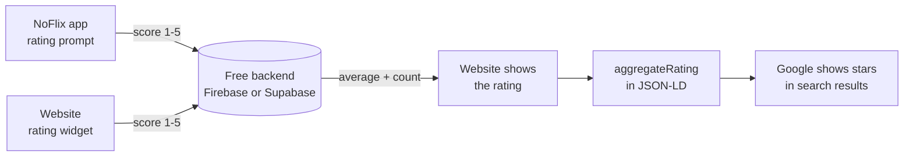

# NoFlix: Star ratings in Google Search

_As of 14 Oct 2026 · Zobaer Hossain_

## Goal

Get NoFlix's Google result to show a star rating, price "Free" and "Android", so more searchers click it. One required field is missing today: a rating from real users.

- The website is live at [zobaer53.github.io/NoFlix](https://zobaer53.github.io/NoFlix/) and passes Search Console's live test (14 Oct 2026).
- Search Console reports "URL has no enhancements" for it, because that rating is missing.
- FAQ rich results are not a fallback: Google now shows them only for government and health sites.

## What Google requires

The page already has every field except the rating. From Google's [software app structured data](https://developers.google.com/search/docs/appearance/structured-data/software-app) docs:

| Field | Required? | On the NoFlix page |
| --- | --- | --- |
| `name` | Required | Yes: "NoFlix" |
| `offers.price` | Required (`0` for free apps) | Yes: `0` |
| `aggregateRating` (average score) or `review` (one review) | Required | **Missing** |
| `applicationCategory` | Recommended | Yes: `EntertainmentApplication` |
| `operatingSystem` | Recommended | Yes: "Android 7.0 or later" |

The fields live in the JSON-LD block in [`docs/index.html`](../docs/index.html).

## Rules the rating must follow

The rating must come from real NoFlix users and be shown on the page; made-up numbers risk a Google manual action. From Google's [review snippet guidelines](https://developers.google.com/search/docs/appearance/structured-data/review-snippet):

- **Real users only.** "Ratings must be sourced directly from users." Numbers we choose ourselves don't count.
- **Visible on the page.** The average and count must be shown to visitors, not only in the hidden JSON-LD.
- **No borrowing.** "Don't aggregate reviews or ratings from other websites." That rules out Reddit, AlternativeTo or APK-site scores. GitHub stars aren't ratings, so they don't count either.
- **Self-rating is allowed for apps.** Google's ban on an entity hosting its own reviews applies to businesses and organisations, not to software apps.

Breaking these can bring a manual action, which removes rich results and can hurt the site's ranking.

## Plan

GitHub Pages can't store anything, so ratings need a small free backend. The website reads the same numbers it shows to visitors and puts them in the structured data, so the two can never disagree.

1. Collect ratings from users: an in-app prompt, a widget on the website, or both.
2. Store each rating in the backend (score 1 to 5, date, device id).
3. Show the live average and count on the website.
4. Put the same average and count into `aggregateRating` in the page's JSON-LD.
5. Google picks it up on its next crawl and can show the stars.

## When to start, and next steps

Start once NoFlix has a steady flow of users; a handful of ratings won't change click-through much.

Open decisions:

- [ ] How many active users or downloads makes this worth building?
- [ ] Where to collect ratings: an in-app prompt, a widget on the website, or both?
- [ ] Which free backend: Firebase or Supabase?
- [ ] How to stop one person rating many times (one rating per device or install)?

Build steps, once decided:

- [ ] Set up the backend and a table for ratings (score 1 to 5, date, device id).
- [ ] Add the rating prompt to the app and/or the site.
- [ ] Show the live average and count on the website.
- [ ] Add `aggregateRating` to the JSON-LD in `docs/index.html`, filled from the same numbers.
- [ ] Check it with Google's [Rich Results Test](https://search.google.com/test/rich-results), then watch Search Console's Enhancements section.

### Sources

- [Software app (SoftwareApplication) structured data](https://developers.google.com/search/docs/appearance/structured-data/software-app), Google Search Central
- [Review snippet guidelines](https://developers.google.com/search/docs/appearance/structured-data/review-snippet), Google Search Central
